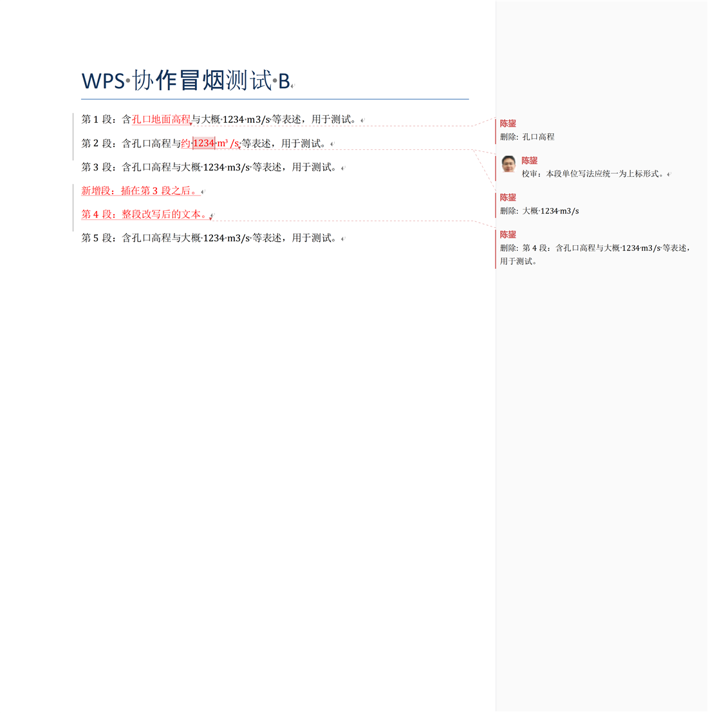
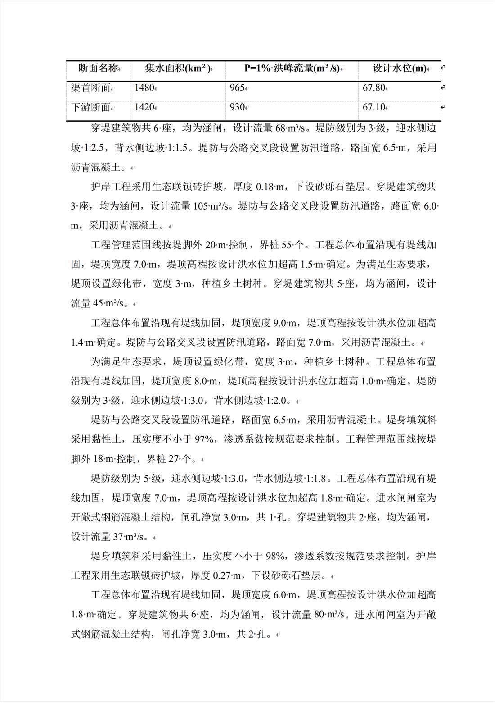

# wps-word-cooperate

**让 AI 在你已经打开的 WPS 文字里改 Word 文档**——不重写文件、改动实时出现在窗口里；文字改动是**修订**，你可以逐条接受或拒绝；排版、表格、题注、目录、批注也都能做。



> 想要更好读的版本？打开 [guide.html](guide.html)（带目录、图示和速查表的网页版说明）。
> 
> 它调的是 WPS 自己的自动化接口（COM），所以：
> **文件开着也能改**（不会因为"文件被占用"失败）· **格式不会走样**（还是 WPS 自己存的）· **你能边看边改**（AI 每次动手前读到的都是文档当下的样子）。

---

## 能干什么

| 场景 | 你能说 | 它会 |
|---|---|---|
| 逐段润色 | "把这份报告按正式文风润色一遍，我能逐条看" | 以**修订**形式改写，你在 WPS 里接受/拒绝 |
| 校审批注 | "按检查要点过一遍，问题直接批注在原文里" | 在对应段落/字句上加批注 |
| 一键排版 | "按水利报告体例排一遍" | 正文仿宋小四、1.5 倍行距、首行缩进 2 字符、标题黑体分级、页边距、页码 |
| 统一字体 | "字体全部改成仿宋" | 正文/表格/页眉页脚/文本框一起换，中英文都换 |
| 表格 | "把这张表做成三线表，表头跨页重复，加表题" | 框线、表头重复、行不跨页、列宽、`表 1` 题注（域，自动编号） |
| 图表 | "插这张图，12 厘米宽，图题在下" / "裁掉左边 25%" | 插图、定宽、裁剪、图题；图缩得太小会提醒你 |
| 目录与引用 | "加目录" / "这几处加 [1][2] 引用，文末生成参考文献" | 目录域、上标引用、参考文献列表（悬挂缩进） |
| 核对版式 | "看看第 3 页排版有没有问题" | 把页面渲成图自己看：表格是否出框、图题是否贴图、有没有半空页 |
| 刷新域 | "把目录和页码更新一下" | 一条命令刷新页码、目录、题注、引用 |



---

## 装它

1. 把整个 `wps-word-cooperate` 文件夹拷到你的技能目录，通常是
   `C:\Users\<你的用户名>\.agents\skills\`
   （也可以在院里的 skill 管理平台里装）
2. 确认这台机器上有 **WPS Office**（文字组件即可）。Windows 10/11 自带的 .NET Framework 4.8 就是它唯一的运行时依赖——**不需要 Python，不需要装插件**。
3. 自检一次：

```powershell
powershell -NoProfile -ExecutionPolicy Bypass -File "C:\Users\<你>\.agents\skills\wps-word-cooperate\scripts\wps.ps1" doctor
```

看到 `wps.installed: true` 就装好了。第一次跑会用系统自带的 `csc.exe` 编译一个约 1 秒的小程序，之后一直用缓存。

---

## 怎么用

**最省事：直接跟 AI 说人话。** 例如：

- "打开 `D:\报告\某报告.docx`，读一遍，把第 3 章里'大概 1234 m3/s'改成'约 1234 m³/s'，我能看着改"
- "给第 86 段加批注：洪峰流量与前文水文计算成果一致，建议补注来源年份"
- "全文正文改成仿宋小四、1.5 倍行距、首行缩进 2 字符，标题 1 黑体三号居中"

**想自己调**（路径按你机器改）：

```powershell
$s = "C:\Users\<你>\.agents\skills\wps-word-cooperate\scripts\wps.ps1"

powershell -NoProfile -ExecutionPolicy Bypass -File $s status
powershell -NoProfile -ExecutionPolicy Bypass -File $s open    -Doc "D:\报告\某报告.docx"
powershell -NoProfile -ExecutionPolicy Bypass -File $s read    -Doc "D:\报告\某报告.docx" -From 1 -Count 60
powershell -NoProfile -ExecutionPolicy Bypass -File $s revise  -Doc "D:\报告\某报告.docx" -Items edits.json
powershell -NoProfile -ExecutionPolicy Bypass -File $s render  -Doc "D:\报告\某报告.docx" -Page 1 -To 3 -Out "D:\报告\_pages"
powershell -NoProfile -ExecutionPolicy Bypass -File $s save    -Doc "D:\报告\某报告.docx"
powershell -NoProfile -ExecutionPolicy Bypass -File $s close   -Doc "D:\报告\某报告.docx"
```

`edits.json` 长这样（`expect` 是"这段开头的几个字"，用来保证改的位置没错）：

```json
{"items":[
  {"para":12,"expect":"3.2 工程地质","op":"replace","find":"孔口高程","replace":"孔口地面高程"},
  {"para":15,"expect":"根据地质勘察","op":"set_text","text":"根据地质勘察成果，坝址区基岩为……"},
  {"para":31,"expect":"本阶段不再","op":"delete"}
]}
```

全部命令与参数见 [SKILL.md](SKILL.md)（那是给 AI 看的说明书，人看也不难懂）。

---

## 三条使用常识

1. **改动默认不落盘**：`revise`/`format`/`table` 这些命令都**不保存**，`save` 才写文件。所以你有充分时间在窗口里看、不满意就 Ctrl+Z（格式类一整批是一次撤销）。
2. **文字改动永远是修订**——不存在"AI 悄悄改掉原文"。排版类改动（字体、表格、目录）不进修订，否则一晚就上千条格式修订。
3. **单位有透明加密时注意交付**：这类机器上 WPS 保存后的 docx 是密文（文件头 `17DA5FA01633CD9A`），**直接发给外单位打不开**。发给别人前先用院里的解密工具（`decrypt-office-pdf`/`FastDycrypt`）处理。详见 [reference/encryption.md](reference/encryption.md)。

---

## 什么时候**不要**用它

- **不需要人在场、上千段一次跑完**的批量润色 → 用离线的 `docx-paragraph-polish`（不依赖 WPS，也不受加密影响）
- **纯排版、无人值守** → `design-report-format`
- **只要一份检查报告、不改原文** → `design-report-review`
- **Excel / PPT** → 这个 skill 只做 Word

---

## 常见问题

| 现象 | 原因与办法 |
|---|---|
| `NO_APP` | 这台机器没装 WPS 文字，或 COM 没注册。手动打开一次 WPS 再试 |
| `NOT_OPEN` | `-Doc` 的路径和实际打开的不是同一个（另存过、短路径、相对路径）。先 `status`，把 `path` 原样复制 |
| `READONLY` | 文件被别处占用或只读。关掉占用的程序，或另存一份再改——别强行覆盖 |
| `ANCHOR_MISSING` | 段落编号漂移或原文对不上。**整批一条都没改**，重新 `read` 核对编号再来 |
| `BUSY` / 超时 | 你正在打字，或 WPS 弹着对话框。关掉对话框，等两秒重试 |
| 中文乱码 | 控制台编码不是 UTF-8。用 `powershell -File` 调脚本（内部已固定 UTF-8），别自己拼 JSON 塞命令行 |
| `wps.exe` 变多 | 中途异常没 `close`。先 `status` 看实例数，只结束**无窗口**的自动化实例，别按名字批量杀 |
| 加粗在截图里看不出来 | WPS 渲图对 Bold 呈现不可靠，docx 里是对的——别据此判断没加粗 |

更多 WPS 与 Word 的差异（样式名只能用中文、表格占用段落号、目录需要标题样式……）见 [reference/wps-quirks.md](reference/wps-quirks.md)。

---

## 给想改它的人

```
scripts/wps.ps1          薄包装：编译缓存 → 写 UTF-8 请求 → 跑 helper → 回 JSON
scripts/helper/
  WpsHelper.cs   1192 行 会话/读/修订/批注/渲染/字体 + JSON + COM 基础 + 格式原语
  Layout.cs       293 行 format / style / page
  Tables.cs      1401 行 table / caption / picture
  Toc.cs          617 行 toc / reference / view
  Text.cs         230 行 fields / cell / insert
tests/                   306 段合成报告 + 独立 COM 校验器（可复跑验收）
reference/               WPS 差异清单、加密与交付
```

- 加一条命令：在对应 `.cs` 里写 `private static object XxxDoc(Bag a)`，在 `WpsHelper.cs` 的 `Dispatch` 里加一行 `case "xxx":`，在 `wps.ps1` 的 `ValidateSet` 和 `switch` 里各加一段。
- 改完直接跑 `wps.ps1 status`：源码哈希变了会自动重编（约 1 秒）。
- 验收：`tests/` 里有语料和校验器，`validate.py` 用 COM 独立核对修订数、接受后的文本、批注、PNG 非空白。
